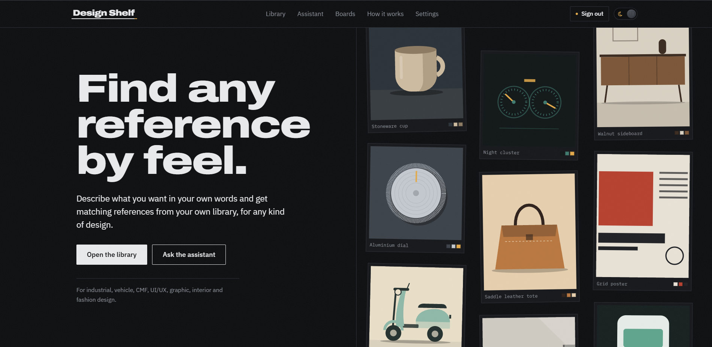
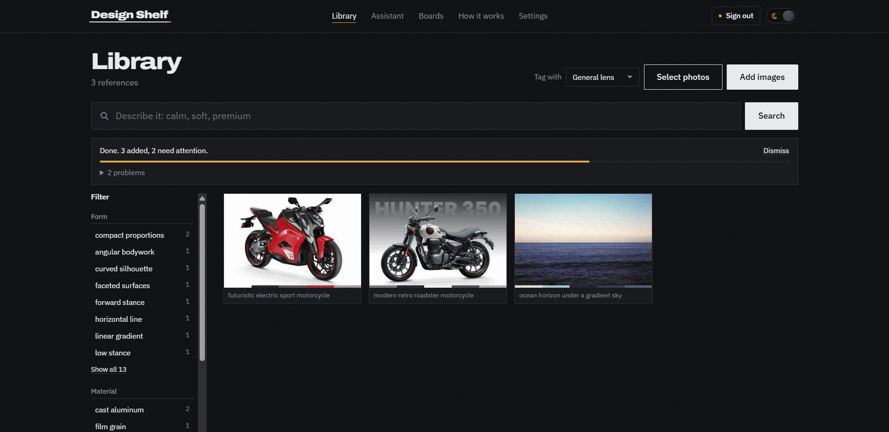
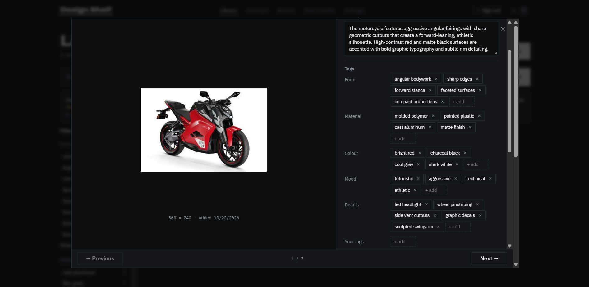
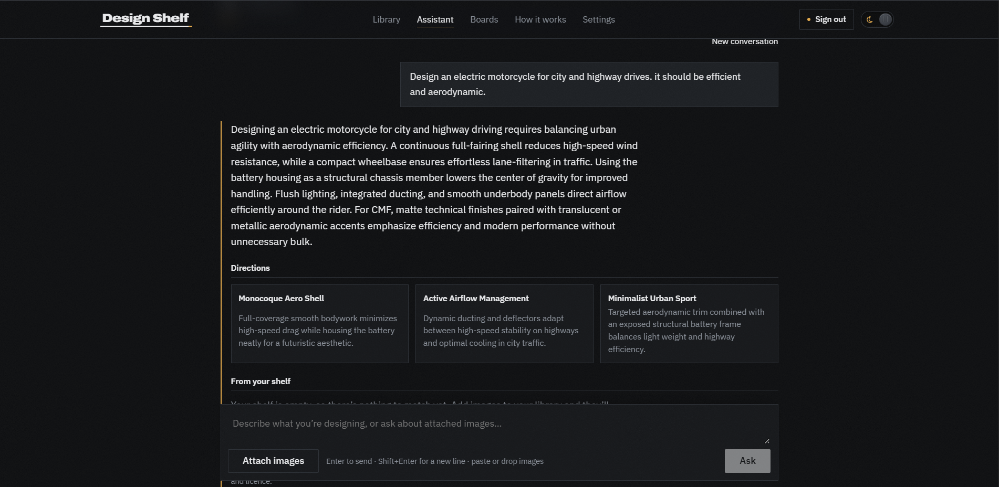
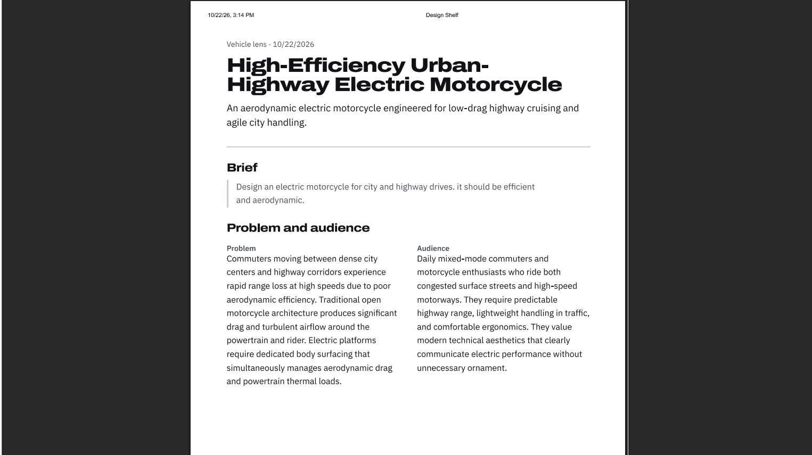
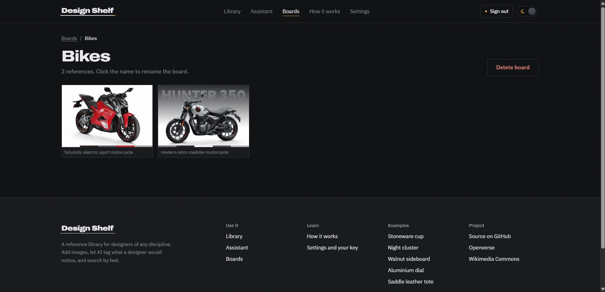
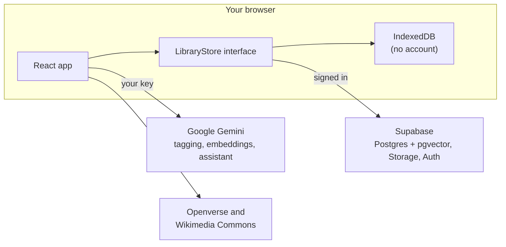

# Live Link: https://design-shelf-phi.vercel.app/

# Design Shelf

**Find any reference by feel.**

A reference library for designers of any discipline: industrial, vehicle, CMF, UI/UX, graphic, interiors, fashion and packaging. Add images, let AI tag what a designer would notice, and search the way you'd describe it: *"calm, soft, premium"*.



## The problem

Designers collect thousands of references: screenshots, product shots, material swatches, posters. They end up in folders named `inspo_final_v3`, Pinterest boards and camera rolls. Finding the one you need means remembering where you saved it, or what you called it.

You remember how a reference *felt*. You rarely remember its file name.

## The insight

Designers describe references in a shared vocabulary of **form, material, colour and mood**: *soft radius, oiled walnut, warm grey, calm*. Each discipline adds its own: a car designer notices stance and proportion, a CMF designer notices gloss level and texture, a UI designer notices hierarchy and spacing.

If every image is tagged in that vocabulary, through the right discipline's eyes, then search by feel works.

## The solution

Design Shelf tags each image with Gemini, using a **lens** for the kind of designer looking. It stores tags, a short description and a real colour palette taken from the pixels. Search compares the *meaning* of your words with each image, then gives a small boost to exact tag matches. So *"quiet"* finds an image tagged *"calm"*.



Open any reference to see and edit what was noticed:



## Features

- **Search by feel.** Hybrid search: embedding similarity plus a keyword boost, with tag filters that combine.
- **Lenses.** General, Industrial, Vehicle, CMF, UI/UX, Graphic, Interiors, Fashion and Packaging, plus your own (for example *repairability*). Re-tag any image with a different lens.
- **Real palettes.** Colours are extracted from each image in the browser. Click a swatch to copy its hex code.
- **Boards.** Group references per project. One image can sit on many boards.
- **Assistant: Ask.** Describe what you're designing, or attach images. You get a short answer, directions to explore, matches from your own shelf, open-licensed photos with their credits, and links to look further on Google Images, Pinterest, Behance, Dribbble, Unsplash and Pexels. Answers stream in as they're written.
- **Assistant: Design doc.** Turn a brief into a structured handoff document: problem and audience, goals and constraints, principles, visual direction, lens-specific directions, references, risks, and a Mermaid architecture diagram. Download it as Markdown, print it to PDF, or save it.
- **Accounts or no accounts.** Use it signed out, with everything in your browser, or create an account (email and password) to sync across devices. You can copy a local library into your account later.
- **Private by design.** You bring your own Gemini API key. It's stored in your browser and sent only to Google.







## How it works



- **One interface, two stores.** Every screen talks to a `LibraryStore`. Signed out, it's IndexedDB in your browser. Signed in, it's Supabase: rows protected by row level security, images in a private bucket, and search by meaning in the database through the `match_images` function (pgvector, cosine distance).
- **Gemini from the browser.** Models are discovered with the ListModels endpoint, not hardcoded. By default, the newest Flash model your key can use is picked; when one hits a rate limit or runs out of quota, the next one is used. Requests go one at a time, and tagging waits behind anything you're actively waiting on.
- **Structured output.** Tagging, Ask and design docs all use JSON schemas, so replies always have the same shape. Gemini never writes image URLs. Real images come from your shelf and from open-licence sources.
- **Open images, credited.** Openverse and Wikimedia Commons results always show the author, licence and a link to the source.

## Run it locally

You need [Node.js](https://nodejs.org) 22.12 or newer and a free [Gemini API key](https://aistudio.google.com/apikey).

```bash
git clone https://github.com/SiddheshK1704/DesignShelf.git
cd DesignShelf
npm install
npm run dev
```

Open http://localhost:5173, go to **Settings**, and paste your Gemini key. Then add images in the **Library**, or choose **Try with sample references**.

Without a `.env.local`, the app runs in local-only mode: everything works except accounts.

### Turn on accounts (optional)

1. Create a project at [supabase.com](https://supabase.com).
2. Copy `.env.example` to `.env.local` and fill in your **Project URL** and **anon / publishable key**. Never use the `service_role` or secret key in the frontend.
3. In the Supabase **SQL Editor**, run [`supabase/schema.sql`](supabase/schema.sql). It creates the tables, row level security policies, the `match_images` function and the private `references` storage bucket, and is safe to run more than once.
4. In **Authentication › URL Configuration**, set the Site URL to `http://localhost:5173` and add `http://localhost:5173/**` as a redirect URL.
5. Check everything with `npm run test:supabase`. It reports each check as pass or fail and never prints your keys.

### Deploy

The repo includes `vercel.json`, so client-side routes work on [Vercel](https://vercel.com). Import the repo with the **Vite** preset and add the two `VITE_SUPABASE_*` environment variables. Then add your live URL to Supabase's **Site URL** and **Redirect URLs**.

## Scripts

| Command | What it does |
| --- | --- |
| `npm run dev` | Start the dev server on port 5173 |
| `npm run build` | Type-check and build to `dist/` |
| `npm run preview` | Serve the production build locally |
| `npm run typecheck` | Type-check only |
| `npm run test:supabase` | Check `.env.local` and your Supabase setup |
| `npm run refs:fetch` | Refresh the landing page's open-licensed reference photos |

## Project structure

```
src/
  components/    UI: navbar, theme switch, dialogs, library grid, assistant
  pages/         Landing, Library, Boards, Assistant, Help, Settings, reference pages
  lib/
    store/       LibraryStore interface, IndexedDB and Supabase implementations
    gemini.ts    Gemini client: model discovery, queue, rate limits, streaming
    search.ts    Hybrid search (embeddings + keyword boost)
    ingest.ts    Upload and tagging queue
    lenses.ts    Built-in lenses and the shared tag vocabulary
    assistant.ts, designDoc.ts, sources.ts, mermaid.ts
supabase/schema.sql      Database, row level security, storage and search function
scripts/                 Supabase check and open-image fetcher
```

## Built with

React, TypeScript, Vite and React Router. Supabase (Postgres, pgvector, Auth, Storage). Google Gemini. Mermaid. Type in Archivo and IBM Plex.

## Credits

- Landing-page reference photos come from [Openverse](https://openverse.org) and [Wikimedia Commons](https://commons.wikimedia.org) under each author's licence; every photo is credited where it appears.
- The collage illustrations are original to this project.
- Archivo and IBM Plex are licensed under the SIL Open Font License.
